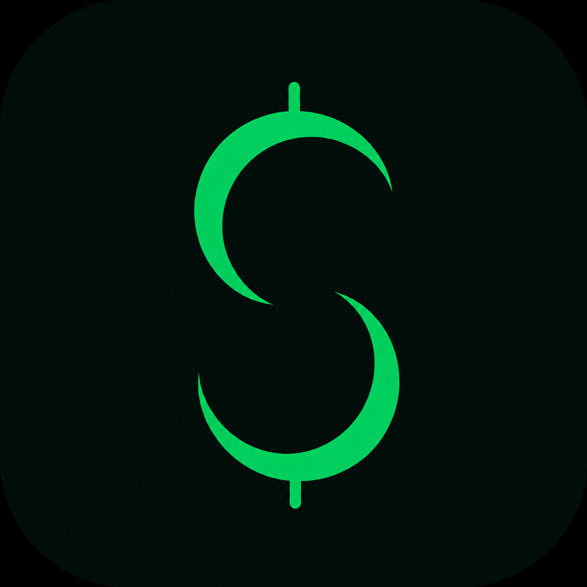

<p align="center">
  
</p>

<h1 align="center">NettKeeping</h1>

<p align="center">A personal finance tracker for Android, built for privacy: all your data stays on your device.</p>

## Features
- No requirement of external services, and everything stays in local storage
- Track income, spending and transfers across multiple accounts
- Visualisation of account balances and investments
- Category breakdowns
- Excel export, plus bulk entry via a spreadsheet template
- Encrypted backup and restore
- PIN / biometric app lock

## Status
Early and personal. This is a project that I use daily, but is prone to changes.

## Running it
```
git clone https://github.com/JoSach07/NettKeeping.git
cd NettKeeping
npm ci
npm run start
```

## How it's built
- React Native + Expo SDK 56, TypeScript
- Local SQLite via expo-sqlite
- **Backups** are encrypted with AES-256-GCM. The key is derived from your backup
  password with PBKDF2-SHA256 (random 16-byte salt, 600,000 iterations).
- **App lock PIN** is never stored. Only a salted PBKDF2 hash is kept in secure storage.
  The lock protects against casual access; it does not encrypt the database.
- UI tests with Maestro (see `maestro/README.md`)

## License
GPL-3.0. See [LICENSE](LICENSE).
